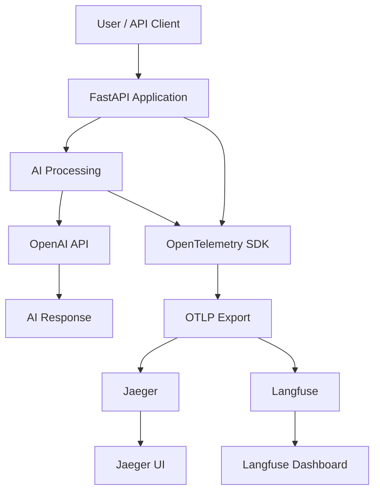

# AI Observability Lab

An end-to-end hands-on project demonstrating observability for AI-powered applications using Python, FastAPI, OpenAI, OpenTelemetry, Jaeger, and Langfuse.

The objective is to understand how to instrument AI applications, capture distributed traces, monitor LLM performance, measure token consumption, and build an extensible AI observability platform.

## Architecture



## Technology Stack

| Component | Technology | Purpose |
|---|---|---|
| Application | Python | Application development |
| API framework | FastAPI | REST API |
| AI model | OpenAI | LLM inference |
| Instrumentation | OpenTelemetry | Telemetry generation |
| Trace protocol | OTLP | Telemetry transport |
| Trace backend | Jaeger | Distributed tracing |
| AI observability | Langfuse | LLM tracing and monitoring |
| Container runtime | Docker | Running Jaeger |

## Project Structure

```text
ai_observability_lab/
│
├── app/
│   ├── main.py
│   └── telemetry.py
│
├── requirements.txt
├── .env
├── .gitignore
└── README.md
```

## Prerequisites

Install the following on your development machine:

- Python 3.10 or higher
- Git
- Docker Desktop
- Visual Studio Code
- OpenAI API account with available API credits
- Langfuse account and project

## 1. Clone the Repository

```bash
git clone https://github.com/sandeepduppalli/ai_observability_lab.git

cd ai_observability_lab
```

## 2. Create Python Virtual Environment

On macOS:

```bash
python3 -m venv venv

source venv/bin/activate
```

## 3. Install Dependencies

```bash
pip install --upgrade pip

pip install -r requirements.txt
```

## 4. Configure Environment Variables

Create a `.env` file in the project root directory.

```bash
touch .env
```

Add the following configuration:

```dotenv
OPENAI_API_KEY=your_openai_api_key

LANGFUSE_PUBLIC_KEY=your_langfuse_public_key
LANGFUSE_SECRET_KEY=your_langfuse_secret_key
LANGFUSE_BASE_URL=https://cloud.langfuse.com
```

Obtain your credentials:

- OpenAI API keys: https://platform.openai.com/api-keys
- Langfuse: https://cloud.langfuse.com

**Security:** Never commit `.env` files, API keys, or other credentials to GitHub.

## 5. Start Jaeger

Start Docker Desktop and wait until the Docker Engine is running.

Execute:

```bash
docker run -d \
  --name jaeger \
  -e COLLECTOR_OTLP_ENABLED=true \
  -p 16686:16686 \
  -p 4317:4317 \
  -p 4318:4318 \
  jaegertracing/all-in-one:latest
```

Verify the container:

```bash
docker ps
```

Jaeger UI:

http://localhost:16686

OTLP endpoints:

- HTTP: http://localhost:4318
- gRPC: localhost:4317

## 6. Start the AI Application

From the project root:

```bash
source venv/bin/activate

python -m uvicorn app.main:app \
  --host 0.0.0.0 \
  --port 8000 \
  --reload
```

Application URL:

http://localhost:8000

Interactive API documentation:

http://localhost:8000/docs

## 7. Available API Endpoints

### Health Check

```http
GET /health
```

Checks application availability.

Example:

```bash
curl http://localhost:8000/health
```

### AI Chat Endpoint

```http
POST /ask
```

Sends a user question to the OpenAI model and returns the generated response.

Example:

```bash
curl -X POST http://localhost:8000/ask \
  -H "Content-Type: application/json" \
  -d '{
    "question": "Explain OpenTelemetry in simple terms"
  }'
```

The response includes:

- AI-generated answer
- Model name
- Request latency
- Input token count
- Output token count

### Application Statistics

```http
GET /metrics-info
```

Returns the application's basic in-memory request counter.

Example:

```bash
curl http://localhost:8000/metrics-info
```

Note: This is an application statistics endpoint, not a Prometheus exporter.

## 8. OpenTelemetry Instrumentation

The application uses OpenTelemetry to generate distributed traces.

Instrumentation includes:

- Automatic FastAPI HTTP request tracing.
- Custom AI processing spans.
- Custom OpenAI API execution spans.
- Model metadata.
- Input and output token attributes.
- Exception recording.

Expected trace hierarchy:

```text
POST /ask
    |
    └── ai.process
            |
            └── openai.chat.completion
```

## 9. Trace Export and Visualization

The OpenTelemetry SDK exports traces to two destinations.

### Jaeger

Jaeger provides distributed tracing visualization.

http://localhost:16686

Search using the service name:

```text
ai-observability-lab
```

Inspect:

- Trace IDs
- Span hierarchy
- Execution duration
- Model attributes
- Token consumption
- Errors

### Langfuse

Langfuse provides AI-specific observability.

https://cloud.langfuse.com

Inspect available:

- AI traces
- Generations
- Model information
- Token usage
- Execution timing

The current integration exports OpenTelemetry spans to Langfuse. Additional generation-specific metadata and evaluation capabilities can be added in future iterations.

## 10. Troubleshooting

### Docker daemon unavailable

Error:

```text
failed to connect to the docker API
```

Solution:

```bash
open -a Docker
```

Wait until Docker Desktop reports that the engine is running.

### OpenAI authentication failure

Error:

```text
401 Unauthorized
```

Check the API key in `.env` and verify it is active.

### OpenAI quota failure

Error:

```text
429 You have no credits remaining
```

Check API billing:

https://platform.openai.com/settings/organization/billing/overview

### No traces in Jaeger

Check:

```bash
docker logs jaeger --tail 50
```

Verify the OTLP HTTP endpoint is reachable and the application is exporting traces.

## 11. Development Roadmap

| Phase | Scope | Status |
|---|---|---|
| Week 1 | FastAPI, OpenAI, OpenTelemetry, Jaeger, Langfuse | Completed |
| Week 2 | RAG, embeddings, vector database, retrieval tracing | Planned |
| Week 3 | Prometheus, Grafana, dashboards and alerting | Planned |
| Week 4 | AI evaluations, hallucination detection, anomaly detection and AIOps | Planned |
| Deployment | Docker, AWS EC2 and Terraform | Planned |

## Learning Objectives

By completing this project, you will understand:

1. How to instrument AI applications using OpenTelemetry.
2. How distributed tracing works across AI application components.
3. How to monitor LLM latency and token consumption.
4. How to correlate application execution with LLM operations.
5. How to build AI-specific observability capabilities.
6. How to extend the solution into an enterprise-grade AI observability platform.

## Repository

GitHub:

https://github.com/sandeepduppalli/ai_observability_lab

---

**Project:** AI Observability Lab  
**Focus:** OpenTelemetry | LLM Observability | AIOps | SRE